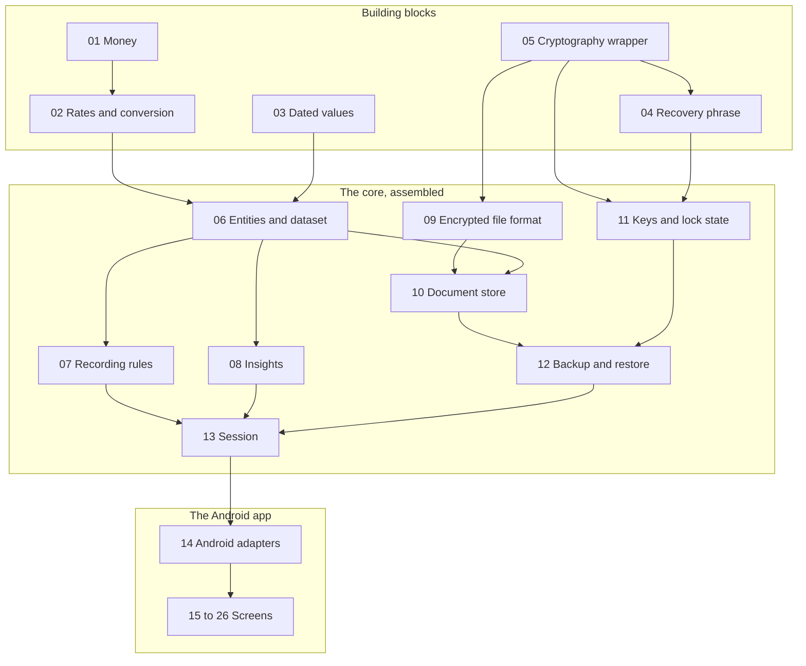

# Fortuna implementation plan

This document orders the work of building the first version (the MVP) in the [roadmap](roadmap.md), using the choices in the [technology document](technology.md). It starts with small, independent pieces of the shared core, each with its own tests, then assembles them, then connects them to the Android app one group of screens at a time. After the MVP, it orders the offline features from the roadmap's future plans the same way.

Starting point: when this plan was written, the repository held the design documents and no code. Step 00 creates the project afresh; the Hello World project from the earlier sanity check is not reused.

## How the plan works

- **One step, one pull request.** Each step is small enough to review in one sitting.
- **Every step ends in something that can be checked.** Either tests that pass, or an installable app that does one more thing than before.
- **Inside out.** The core is finished and tested before any real screen is built, so the screens only display and collect. They hold no financial or security logic.
- **Checked without a computer.** From step 00, every pull request runs the core tests, compiles the Linux target and builds a debug app that can be downloaded and installed on a phone.
- **Tests come from the documents.** The worked examples in the [architecture](architecture.md) and each rule in the [user flows](user-flows.md) become named test cases.

Four stages build the MVP, and six more follow it:

| Stage | Steps | What exists at the end |
|---|---|---|
| Foundation | 00 | An empty project that builds, tests and produces an app on every pull request |
| Building blocks | 01 to 05 | Five independent pieces, each tested alone |
| The core, assembled | 06 to 13 | The whole app working without a screen, proven by an end-to-end test |
| The Android app | 14 to 26 | The MVP, a group of screens at a time, then the release check |
| After the release check | 27 | What the manual test run found, fixed |
| Recording without limits | 28 to 33 | Closed sources, own categories, history in any order, imports, a new base currency, tags |
| Protecting more data | 34 to 36 | A new PIN or phrase, backups offered and automatic, restore over existing data |
| Keeping it up to date | 37 and 38 | Out-of-date markers, reminders and a quicker update |
| Insights | 39 to 43 | Allocation, a projection, goals, debt payoff and a year in review |
| Data out and sharing | 44 to 46 | Spreadsheet export, shared pictures and a home-screen widget |

## Steps at a glance

| Step | Name | Result | Checked by |
|---|---|---|---|
| 00 | Project skeleton and checks | Two modules, the three checks, a hardened manifest | Checks pass; app installs |
| 01 | Money | Exact amounts in a currency's smallest unit | Tests |
| 02 | Rates and conversion | Decimal rates, one rounding rule | Tests |
| 03 | Dated values | "Latest on or before a date" lookup | Tests |
| 04 | Recovery phrase | Twelve words to and from random bytes | Tests |
| 05 | Cryptography wrapper | Encrypt, decrypt, derive a key, hash, random bytes | Tests |
| 06 | Entities and dataset | The domain model and its saved form | Tests |
| 07 | Recording rules | Every change the MVP allows, with its rules | Tests |
| 08 | Insights | Net worth, timeline, source history | Tests |
| 09 | Encrypted file format | One versioned format for the store and backups | Tests |
| 10 | Document store | Load, change and save the dataset safely | Tests |
| 11 | Keys and lock state | PIN, recovery phrase, growing delay | Tests |
| 12 | Backup and restore | Export a file, restore it on a fresh device | Tests |
| 13 | Session | The app's states and auto-lock; the whole core end to end | Tests |
| 14 | Android adapters | Keystore, private files, clock, lifecycle | Tests on a device |
| 15 | Setup and unlock | S-01 to S-05, S-07 | App |
| 16 | First source and dashboard | S-11, S-09 | App |
| 17 | Source page and value entry | S-10, S-12 | App |
| 18 | Periodic update | S-13, S-14 | App |
| 19 | Foreign currencies | Rate entry, S-15, S-16 | App |
| 20 | Recovery, backup and restore | S-08, S-17, S-06 | App |
| 21 | Charts | Timeline on S-09, history on S-10 | App |
| 22 | Welcome screen | A reworked S-01, agreed before it is built | App |
| 23 | Hide amounts | An eye on S-09 that hides every amount in the app | App |
| 24 | Bug reports | S-18, a saved record of crashes, links from S-01, S-07 and S-15 | App |
| 25 | Biometric unlock | The `Biometric gate` port, a prompt on S-07, a switch on S-15 | App |
| 26 | MVP release check | Frozen file format, release build | App |
| 27 | Release check fixes | App switcher, restore, rate delete, debt sign, phrase entry | App |
| 28 | Close a source | Closing value, archive, reopen (UF-07) | Tests; app |
| 29 | Manage categories | A categories screen under S-15 (UF-08) | Tests; app |
| 30 | Backfilling | Values at any date, adjustments to confirm (UF-06) | Tests; app |
| 31 | Spreadsheet import | A template and an import that checks every row (UF-15) | Tests; app |
| 32 | Change base currency | A choice on S-16, figures recalculated (UF-09) | Tests; app |
| 33 | Tags and chart markers | Tags on values, markers on the charts | Tests; app |
| 34 | Security settings | Change the PIN, replace the phrase and data key (UF-16) | Tests; app |
| 35 | Backup prompts and automatic backups | An offer after updates, scheduled backups to a folder (UF-12) | Tests; app |
| 36 | Restore over existing data | Restore from S-17 on a phone with data (UF-13) | Tests; app |
| 37 | Out-of-date markers and reminders | Update frequency, markers on S-09, local notifications | Tests; app |
| 38 | Periodic update extras | "Unchanged", the typing-mistake check, a summary (UF-04) | Tests; app |
| 39 | Allocation by category | Net worth split by category (UF-10) | Tests; app |
| 40 | Projection | Where net worth is heading, as an estimate | Tests; app |
| 41 | Goals | Targets with progress and a projected date | Tests; app |
| 42 | Debt payoff | A payoff date for each debt | Tests; app |
| 43 | Year in review | Each year's change, split | Tests; app |
| 44 | Spreadsheet export | An unencrypted copy in the import's layout | Tests; app |
| 45 | Share a picture | A share action with amounts shown or hidden (UF-17) | Tests; app |
| 46 | Home-screen widget | Net worth on the home screen, opt-in | App |

Screen numbers refer to the [screen map](screen-map.md).

## What depends on what

- Steps 01, 03 and 05 depend on nothing and can be done in any order. Step 04 needs SHA-256 from step 05 for its checksum, so 05 is built first.
- The domain steps (06 to 08) and the protection steps (09, 11) do not depend on each other. They meet at step 10.
- The building blocks are packages inside the `core` module, not separate Gradle modules. This follows the two-module structure in the technology document. The arrows above are the only dependencies allowed between packages.

## Stage 1: foundation

### Step 00: project skeleton and checks

- **Builds:**
  - Gradle with the Kotlin DSL and a version catalog.
  - `core`: a Kotlin Multiplatform module with Android, JVM and Linux targets, and all code in the common source set.
  - `androidApp`: the Hello World app, with its greeting supplied by a function in `core`.
  - Minimum SDK 26, compile and target SDK 37.
  - Manifest: no `INTERNET` permission, `allowBackup` off, data extraction rules that exclude the app's files.
  - GitHub Actions on every pull request: run the core tests, compile the Linux target, build the debug app and attach it.
  - Signing: debug builds use one fixed key, held as a GitHub secret, so each build installs over the last.
- **Tests:** one trivial core test, and a check that the built app's manifest does not contain the `INTERNET` permission.
- **Done when:** a pull request shows all checks passing, and the app downloaded from it installs and shows the greeting from `core`.

## Stage 2: building blocks

Each block is pure Kotlin with no file access, no clock and no dependency on the others, except that rates build on money and the recovery phrase takes SHA-256 from the cryptography wrapper.

### Step 01: money

- **Builds:** `Currency` (code and number of decimal places, from a fixed list built into the core and taken from ISO 4217) and `Money` (a whole number of the smallest unit, in one currency). Reading an amount from decimal text and writing it back. Add, subtract and negate.
- **Tests:**
  - "10000.00" in pounds is 1,000,000 pence and writes back unchanged.
  - A currency with no decimal places, such as yen.
  - Too many decimal places is rejected.
  - Adding two different currencies is rejected.
- **Done when:** no floating-point type appears anywhere in the package.

### Step 02: rates and conversion

- **Builds:** `Rate`, read from decimal text and kept exactly as typed, in either direction ("1 USD = 0.75 GBP" or "1 GBP = 1.33 USD"). One conversion function: multiply or divide by the rate with exact whole-number arithmetic, then round half away from zero to the target currency's smallest unit.
- **Tests:**
  - From the architecture's example: $10,000 at 0.80 is £8,000, and $11,500 at 0.75 is £8,625.
  - Results that land exactly half-way.
  - Negative amounts: converting −x gives minus the conversion of x.
  - Currencies with different numbers of decimal places.
  - A zero or negative rate is rejected.
  - A rate typed the other way round gives the same result as its exact inverse.
- **Done when:** conversion and rounding exist in exactly one function, and no floating-point type appears in the package.

### Step 03: dated values

- **Builds:** a small generic collection of records keyed by calendar date (`kotlinx-datetime`). It answers "the latest on or before this date" and enforces one record per date, where a second entry for a date replaces the first. Snapshots and rates both use it.
- **Tests:** empty; a date before the first record; an exact date; between two records; after the last; replacing a record.

### Step 04: recovery phrase

- **Builds:** the 2,048-word BIP39 list held in the core. Sixteen random bytes become twelve words, and twelve words become the bytes again after the checksum is verified. Typed input is tidied (case, extra spaces). An unknown word is reported by its position.
- **Tests:**
  - The published BIP39 test vectors, in both directions.
  - A fixed example with one word swapped for another fails the checksum.
  - A word not in the list is named in the error.
- **Done when:** the package takes its random bytes as input and its SHA-256 from the step 05 wrapper, so it needs no cryptography library of its own.

### Step 05: cryptography wrapper

- **Builds:** a small interface of our own with five operations: random bytes, AES-256-GCM encryption and decryption with authenticated extra data, PBKDF2 key derivation, and SHA-256 for the recovery phrase's checksum. It is implemented with `cryptography-kotlin`, and nothing else in the core imports that library.
- **Tests:**
  - Published test vectors for AES-GCM, PBKDF2 and SHA-256.
  - Encrypt then decrypt returns the original.
  - A changed byte in the data, a changed byte in the extra data, and a wrong key are each rejected.
- **Done when:** the tests pass on the JVM and the Linux target compiles.

## Stage 3: the core, assembled

### Step 06: entities and dataset

- **Builds:** the entities in the architecture (category, source, snapshot, currency, exchange rate, settings) and one immutable `Dataset` that holds them all. The fixed starter categories. Reading and writing the dataset as JSON with `kotlinx.serialization`, including a format version.
- **Tests:**
  - A dataset written and read back is equal to the original.
  - A sample JSON file kept in the repository loads. This is the first format fixture.
- **Done when:** the dataset can express everything in the architecture's domain model, including the fields the MVP does not show yet (status, update frequency, the revision number and the revision of the last backup), so the saved format does not need to change when those features arrive.

### Step 07: recording rules

- **Builds:** every change the MVP allows, as a function that takes a dataset and returns either a new dataset or a named error. No function changes anything in place.
  - Choose the base currency.
  - Add a source with its opening snapshot.
  - Add a snapshot, edit a snapshot's value, amount added and note, and delete a source's latest snapshot unless it is the only one.
  - Delete a source that has only its opening snapshot.
  - Add, correct and delete an exchange rate.
  - The periodic update's queue: the active sources whose latest snapshot is before the update date, the one updated longest ago first; the number of sources left out because they already have a value on or after that date; and the foreign currencies in use with each one's last rate and its age.
  - Every function that takes a date is also given today's date, so the rules stay free of the clock.
- **Tests:** one named test for each rule.
  - Names are unique among active sources.
  - The opening snapshot has no amount added.
  - A new snapshot must be dated on or after the source's latest one (MVP simplification).
  - A new snapshot dated the same as the latest one replaces it.
  - A replacement for the opening snapshot has no amount added.
  - A snapshot or a rate dated in the future is rejected.
  - The update queue leaves out a source with a value on or after the update date, and counts it.
  - A snapshot's date cannot be edited.
  - A foreign-currency source needs a rate on or before its opening date.
  - The rate that covers a currency's earliest snapshot cannot be deleted.
  - The base currency's rate is always one.
  - A second rate for a date replaces the first.
  - A source with more than its opening snapshot cannot be deleted.
  - A negative value is accepted for an asset and for a liability.
  - A source's only snapshot cannot be deleted; the source is deleted instead.
  - The opening snapshot's amount added stays zero, when added, replaced or edited.
- **Done when:** every rule under "Rules" in the architecture that applies to the MVP has a test that names it.

### Step 08: insights

- **Builds:** calculations over a dataset. Nothing is stored.
  - Net worth on a date: total assets, total liabilities and the difference, in the base currency.
  - The source list: each source's current value in its own currency and, for a foreign source, in the base currency, and the date it was last updated.
  - A source's history: for each snapshot, the change since the previous one, the amount added and the growth, with totals since the opening balance.
  - The timeline: net worth on each date in a period on which a value or a rate changed.
  - The split of a change between two snapshots into added, growth and currency effect, with the currency effect taken as the remainder.
- **Tests:**
  - The architecture's worked example: the £625 rise splits into £750 added, £375 growth and −£500 currency effect.
  - The parts add up to the total after rounding: $10.01 to $10.02 with nothing added, at rates 0.333 and 0.337, is a £0.05 rise made of £0.00 growth and £0.05 currency effect.
  - A liability is subtracted.
  - A source does not count before its opening date.
  - A source with no new snapshot keeps its last value.
  - A transfer recorded as a negative and a positive amount added cancels in the total.
  - A new rate moves net worth on its own date.
- **Note:** the currency effect is not shown in the MVP. The two-snapshot split is built now because the technology document names it as one of the first things to test and it exercises steps 01 to 03 together. The split across all sources for a period is left for after the MVP.

### Step 09: encrypted file format

- **Builds:** one file format used by both the store and backups. A header (a marker, the format version, key derivation settings, salts and the nonce) followed by the dataset encrypted with AES-256-GCM. The header is authenticated together with the data. A backup is the same file with the recovery-locked copy of the data key in its header.
- **Tests:**
  - Seal then open returns the original bytes.
  - Changing any single byte of the header or the body is rejected.
  - A wrong key is rejected.
  - An unknown format version is rejected with its own error, before anything is decrypted.
  - A file kept in the repository opens with a known key. This is the fixture that later versions must keep reading.

### Step 10: document store

- **Builds:** the `Private files` port and its Okio implementation. The store: open the file with the data key and hold the dataset in memory, exposed as a flow; apply a recording rule, raise the revision number by one and write the result as a new file that is moved into place; discard the key and the dataset on lock. On start, recover a new file left waiting by an interrupted move. The store is the one place the revision is raised. It also offers a second kind of write for bookkeeping, such as the record of a backup, which saves without raising the revision.
- **Tests:** against Okio's in-memory file system.
  - A change is still there after the store is closed and reopened.
  - Each saved change raises the revision by one.
  - A rule that returns an error leaves the file and the revision untouched.
  - A write interrupted before the move leaves the old data readable.
  - A write interrupted after the move is recovered on start.
  - After locking, the store holds no data.

### Step 11: keys and lock state

- **Builds:**
  - The data key, and its two locked copies: one under the PIN (PBKDF2, then wrapped by the device key) and one under the recovery phrase (PBKDF2 only).
  - The `Device key` and `Clock` ports, with stand-ins for tests.
  - The lock state file: the locked copies, salts and settings, and the count of failed attempts. It has its own format version.
  - Operations: set up with a PIN and return the phrase, in two parts so nothing is saved until setup finishes; unlock with the PIN; recover with the phrase and set a new PIN.
  - PIN rules: digits only, six or more.
  - The growing delay. The count is saved before a PIN is checked, so closing the app during an attempt cannot avoid it.
- **Tests:**
  - Set up, then unlock with the right PIN.
  - A wrong PIN is refused, the count rises and the wait grows.
  - The count and the wait survive a restart.
  - A right PIN during the wait is still refused.
  - Recovery with the phrase sets a new PIN, leaves the phrase and the data unchanged, and clears the count.
  - A wrong phrase changes nothing.
  - A lock state copied to a device with a different device key cannot be opened with the PIN.

### Step 12: backup and restore

- **Builds:** export, which produces the backup file without asking for the phrase and, once the file has been saved, records the date of the backup and the revision it was made at, without raising the revision. Restore, which opens a backup with the phrase, then writes the store and a new lock state under a new PIN in one go.
- **Tests:**
  - Back up on one stand-in device and restore on another: the datasets are equal.
  - After a backup, the revision of the last backup equals the current revision. A change made later the same day raises the current revision past it.
  - After a restore, the two revisions are equal.
  - A wrong phrase changes nothing on the device.
  - A damaged file changes nothing on the device.
  - A backup file kept in the repository restores with a known phrase.

### Step 13: session

- **Builds:**
  - The app's states: no data, setting up, restoring, locked, unlocked. One entry point for the interface, which exposes the current state as a flow and offers the use cases for recording, insights and backup.
  - The `App lifecycle` port and the auto-lock rule: lock one minute after leaving the foreground, two minutes if a value is being entered, and always when the app is closed or the phone restarts.
- **Tests:**
  - The grace periods, run against a virtual clock.
  - No use case is reachable while locked.
  - **End to end, with no screen:** set up; add an asset, a liability and a foreign-currency source; run two periodic updates with a skipped source; lock and unlock; correct a value; back up; restore on a second stand-in device; check net worth and each source's history at every stage.
- **Done when:** the end-to-end test passes. From here on, the Android work adds no logic.

## Stage 4: the Android app

Each step from 15 onward produces an app that does one more useful thing. Screens get a view model that calls the session, and view model tests that use the real core with stand-in ports.

The screens where a value is entered (S-11 to S-14) each get the two-minute grace period, and keep what was typed across a lock, in the step that builds them.

### Step 14: Android adapters

- **Builds:** `Device key` on the Android Keystore (StrongBox where the phone has it), `Private files` on the app's private directory, `Clock`, and `App lifecycle` on `ProcessLifecycleOwner`. The core is created once and handed to the interface.
- **Tests:** run on a device or emulator, from the Device tests workflow, which is started by hand.
  - A secret wrapped by the device key unwraps after the app is restarted.
  - A file replaced through the adapter is complete after a restart.
  - The core's cryptography tests pass on the lowest supported Android version.
- **Done when:** the app from step 00 starts, creates the core and reports "no data on device".

### Step 15: setup and unlock

- **Builds:** S-01 Welcome (new start only), S-02 Create PIN, S-03 Recovery phrase, S-04 Confirm phrase, S-05 Base currency, S-07 Lock, and a placeholder dashboard. Navigation, with the lock screen placed over whatever was open. `FLAG_SECURE`. The one-minute auto-lock.
- **Done when:** on a phone, the user can complete setup, close the app, reopen it, be refused with a wrong PIN and made to wait, and get in with the right one. Figures and the phrase do not appear in the app switcher.

### Step 16: first source and dashboard

- **Builds:** S-11 Add source, limited to the base currency for now. S-09 Dashboard with net worth, total assets, total liabilities and the source list, and the empty state that invites the first source.
- **Done when:** the user can add an asset and a liability and see the three totals. The data is still there after locking and after restarting the phone.

### Step 17: source page and value entry

- **Builds:** S-10 Source, with the snapshot list (change, amount added and growth for each) and totals since the opening balance. S-12 Value entry for a new value and for editing one, with the confirm dialog when a new value replaces the one already recorded for that date. Deleting the latest snapshot, and deleting a source that has only its opening snapshot, each behind the confirm dialog.
- **Done when:** the user can record a new value, correct it, replace it by entering the same date again, delete it, and remove a source created by mistake. The dashboard totals follow each change.

### Step 18: periodic update

- **Builds:** S-13 Update, with the date and the number of sources left out, and no rates for now. S-14 Update: source step, which walks the sources from the one updated longest ago, and lets the user enter a value and amount added or skip.
- **Done when:** the user can update every source in one sitting, leave half-way, and on starting again with the same date continue with the sources not yet updated. An update dated before a source's latest value leaves that source out and says so.

### Step 19: foreign currencies

- **Builds:** the rate entry dialog. The full currency choice on S-11, which asks for a rate when the currency has none. The rates section of S-13. S-15 Settings and S-16 Currencies and rates.
- **Done when:** the user can add a source in another currency, see its value in both currencies on the dashboard and counted in the base currency, enter a newer rate during an update or from settings, and see net worth move. The rate that the earliest snapshot depends on cannot be deleted.

### Step 20: recovery, backup and restore

- **Builds:** a twelve-word entry component, shared by two screens. S-08 Enter recovery phrase. The `Document picker` port on the Storage Access Framework. S-17 Backup. S-06 Restore, with the restore choice added to S-01.
- **Done when:** on a phone, the user can get back in with the phrase and set a new PIN; export a backup; uninstall the app, install it again and restore from the file. A wrong phrase or a damaged file leaves the fresh install unchanged.

### Step 21: charts

- **Builds:** one chart composable, with the library chosen here (decided: Vico). The net worth timeline on S-09 and the value over time on S-10.
- **Done when:** both charts draw from the figures step 08 already produces, and still read sensibly with one data point, with two, and with several years of history.

### Step 22: welcome screen

- **Builds:** a reworked S-01, the first screen a new user sees.
  - **What it says:** what Fortuna does; that everything stays on the phone, with no account and no network; and what losing both the PIN and the recovery phrase means, said plainly without alarming.
  - **How it looks:** the app's mark, a clear order of importance, and the two choices, a new start and a restore, easy to tell apart.
  - **Everywhere:** it follows the responsive rules, so on a wide window the explanation sits beside the choices, and it works with the largest text size and with TalkBack.
  - **Agreed first:** the design is reviewed and agreed before it is built. Agreed: a picture of the mark in its rings with three icons, and three rows that explain them; see [visual design](visual-design.md). The restore choice and the bug-report link are added by the steps that bring them.
- **Done when:** it is approved on a phone and on a tablet or foldable, in the light and dark themes, and at the largest text size.

### Step 23: hide amounts

- **Builds:** an eye button in the S-09 top bar that hides every amount in the app, for when someone might see the screen (UF-19).
  - **Decided: the whole app.** Hidden on the dashboard means hidden on the source pages, the update screens and the charts too, so opening a source never shows its figures.
  - **What changes:** every amount becomes the same six dots, whatever its size. Charts keep their shape but lose the figures on their axis and in the marker. TalkBack says "hidden" for each. Amounts being typed into a form stay visible; rates, dates and names are not amounts and stay too.
  - **Remembered:** the choice is kept on the phone between launches, outside the encrypted data, so turning it on or off never makes a backup out of date.
- **Tests:** the choice is remembered; with amounts hidden, no amount is shown anywhere on the dashboard and TalkBack hears "hidden"; the eye hides and shows again.
- **Done when:** on a phone, amounts can be hidden from the dashboard, stay hidden on every screen and after the app is closed and opened again, and come back with the same button.

### Step 24: bug reports

- **Builds:**
  - **S-18 Report a bug:** the user describes the problem, sees the whole report, and sends it from their email app, addressed to the support address and filled in. Fortuna has no network access, so the report always leaves through an app the user chooses and sees.
  - **What a report holds:** the user's description, the app's version, the Android version and the phone's model. Never amounts, names, dates of entries, the PIN or the phrase.
  - **A saved record of crashes:** when the app crashes, it saves where in the code the crash happened: the kind of error and the code locations, without the error's message, which could hold figures. Next time the app opens, it offers to report the crash. The user sees the full text before anything is sent, and can delete the record instead. Only the latest few crashes are kept.
  - **Where it is offered:** S-15 Settings, and a small link on S-01 Welcome and S-07 Lock, so problems with setup or unlocking can be reported without getting in.
- **Tests:** a report never holds a figure, a source name, the PIN or the phrase; a crash record keeps code locations and drops messages; the email is addressed and filled in.
- **Done when:** on a phone, a report can be sent from settings, from the lock screen and from the welcome screen, and a crash forced in a debug build is offered for reporting on the next start.

### Step 25: biometric unlock

- **Builds:** biometric unlock (UF-02), moved forward from after the MVP so the first release has it.
  - **The `Biometric gate` port** on the Android Keystore and `androidx.biometric`. The data key is encrypted under a Keystore key that needs a strong biometric check for every use and is voided when fingerprints or faces change.
  - **Decided: its own file.** The biometric copy is a small file beside the lock state, not in it, so the lock state's version 1 format is unchanged. Turning biometric unlock off deletes that file and its key.
  - **Decided: offered after setup, with a switch in settings.** After setup or a restore, a phone with a strong biometric asks once. S-15 has a switch.
  - **On S-07:** the prompt appears by itself once each time the lock screen comes to the front, with the PIN pad beneath and a "Use fingerprint" button to ask again.
  - **The core** gives the data key while unlocked, and opens with a key the platform returns; a wrong key changes nothing and counts as no PIN attempt.
  - **On S-07, before it is on:** a "Use fingerprint next time" switch on a phone that can; it is turned on, with a fingerprint to confirm, once the PIN is right.
  - **When fingerprints change,** Android voids the key. The lock screen checks for this as soon as it appears, without asking for a fingerprint: biometric unlock turns itself off, and the lock screen says why, every time it appears, until the user is in with the PIN. The PIN still works.
- **Tests:** the core opens with the key it gave, refuses a wrong one without a wait; the offer comes once after setup and not on a phone without a sensor; the lock screen asks once per lock; changed fingerprints or a stale copy turn it off.
- **Done when:** on a phone, biometric unlock can be turned on from the offer and from settings, opens the app from the lock screen, falls back to the PIN when cancelled, and turns itself off with a message after a fingerprint is added.

### Step 26: MVP release check

- **Builds:** nothing new. The file formats are frozen as version 1 and their fixtures are locked. A release build with code shrinking, with its mapping file kept so crash reports can be read. Empty and error states on every screen. A manual test script that follows the flow coverage table in the screen map.
  - **Decided: signing.** Release builds are `app.arpits.fortuna`, signed with the upload key named in `keystore.properties`, which stays out of the repository; without it they are unsigned. CI's release check names the debug key there instead, so its build installs for testing. Debug builds are `app.arpits.fortuna.debug`, so both share a phone.
  - **Built:** the formats are frozen with a test that locks each fixture by its SHA-256; a lock-state fixture joins the dataset and backup ones. CI's "Release app" job builds the shrunk APK and keeps its mapping file. Data that cannot be read after a right PIN is explained on the lock screen instead of crashing the app. The script is the [manual test script](manual-test-script.md).
- **Done when:** every MVP flow in the roadmap passes the manual script on a real phone, with a release build.

## Flow coverage

| MVP flow | Core steps | App step |
|---|---|---|
| UF-01 First-time setup | 04, 07, 11, 13 | 15, and 22 for the welcome screen |
| UF-02 Unlock the app | 11, 13 | 15 |
| UF-03 Add a source | 07 | 16, and 19 for foreign currencies |
| UF-04 Periodic update, basic | 07 | 18, and 19 for rates |
| UF-05 Update a single source | 07 | 17 |
| UF-06 Corrections, basic | 07 | 17 |
| UF-09 Currencies and rates, basic | 02, 07 | 19 |
| UF-10 Net worth, basic | 08 | 16, and 21 for the timeline |
| UF-11 View a source, basic | 08 | 17, and 21 for the chart |
| UF-12 Back up | 12 | 20 |
| UF-13 Restore from a backup | 12 | 20 |
| UF-14 Recover from a forgotten PIN | 11 | 20 |
| UF-18 Report a bug | none | 24 |
| UF-19 Hide amounts | none | 23 |

## Decisions to make along the way

The design documents leave these open. Each is listed with the step that needs it and a suggested answer.

| Decision | Needed at | Suggestion |
|---|---|---|
| How the timeline picks its dates | 08 | Every date on which a value or a rate changed |
| How many words S-04 asks for | 15 | Three, at random positions |
| Chart library | 21 | Decided: Vico, behind one `ValueChart` composable; the technology document gives the reasons |
| Support email address for bug reports | 24 | Decided: support.fortuna@gmail.com, a dedicated address for Fortuna |

Decided since this plan was written:

- **Rounding of negative amounts:** half away from zero, so converting −x always gives minus the conversion of x and transfers still cancel.
- **Currencies offered:** a fixed list built into the core, taken from ISO 4217, with the decimal places of each.
- **Minimum SDK:** 26, which removes the doubt about PBKDF2 with SHA-256 on Android 7. Step 14's device test still confirms it on the lowest supported version.
- **Signing of debug builds:** one fixed key, held as a GitHub secret.
- **PBKDF2 rounds:** for the PIN, measured on the device whenever a PIN is set to take about a quarter of a second, with a floor of 100,000; for the recovery phrase, a fixed 100,000. The phrase's 16 secret bytes are what is fed in. Every round count is stored with its locked copy.
- **The growing delay:** three free attempts, then 1, 5, 15 and 60 minutes, then 24 hours for each attempt after that. The data is never erased.
- **Timing the wait:** by the device's clock since start-up, with the boot count to tell start-ups apart. A restart makes the current wait begin again.
- **Device tests:** a separate workflow, started by hand, runs them on emulators at Android 8.0 and Android 16. Pull requests only compile them.
- **Device key and the phone's own lock:** the key does not require the phone to be unlocked, so changing the phone's screen lock never destroys it.
- **PIN entry:** on the app's own number pad, never the phone's keyboard.
- **Confirming the phrase:** three words at random positions. A wrong answer leads back to the phrase.
- **Responsive layout:** every screen, from step 15 on, adapts to the window's width class, so tablets and foldables work well. The technology document has the rules.
- **Amount added:** optional when entering a value; left blank, it counts as nothing added. The field explains it, with a minus sign for withdrawals or repayments.
- **Entering a rate:** it starts as 1 unit of the foreign currency in the base currency, such as 1 USD = … GBP, with a button to type it the other way round. Either way it is kept as typed.
- **Amounts on screen:** each in its own currency's style (pounds as Britain writes them, rupees as India does, euros in the phone's language where it is a euro country's), with each currency's own decimal places. Dates follow the phone.
- **Bug reports:** by email, prefilled, through the user's own email app. A saved record of crashes, which the user reviews before sending. Offered in settings and on the welcome and lock screens.
- **Interrupted setup:** nothing is saved until setup finishes. The store is written first and the lock state last, and the lock state marks that data exists; a store without one is removed on start.

Two notes on working order:

- **Data is disposable until step 20.** Before backup and restore exist, and before the format is frozen in step 26, real history should not be kept only in the app.
- **The saved format may change until step 26.** After that, any change needs a new format version and a new fixture.

## After the MVP

The future plans in the roadmap that work without a network, as steps 27 to 46. They follow the same rules as the MVP steps: one step, one pull request; the core first, with tests, then the screen.

The order follows four ideas:

- **Fix what the release check found first,** before the first release reaches people.
- **Settle the data model before building on it.** Recording changes come before the insights that read history, so nothing is built twice.
- **Protect more as there is more to lose.** Security and backup steps follow the steps that let users enter years of history.
- **Let data leave the app last.** Export, sharing and the widget show figures outside the app's protection, so they come once everything else is in place.

Two features from the roadmap are already in the MVP: the change breakdown for a period and the base-currency view of a source.

**The saved format after step 26.** Every step that changes what is saved adds a new format version and fixture, and still reads every older version, including backups made by earlier releases. Steps 29, 33, 35, 37 and 41 are expected to change it; step 28 did not need to, as version 1 already saves a source's status.

## Stage 5: after the release check

### Step 27: release check fixes

- **Builds:** fixes for what the manual test run of step 26 found.
  - **App switcher:** the app covers its content as it goes into the background, so its card in the app switcher never shows figures, even when the user swipes straight into it.
  - **Restore:** a file that is not a Fortuna backup is refused as soon as it is chosen, before the phrase and the PIN are asked for.
  - **Deleting a rate:** a rate that cannot be deleted is refused straight away, with the reason, instead of after the confirm dialog.
  - **Debt interest:** the amount and the percentage of a debt's interest have the same sign.
  - **Phrase entry:** a misspelt word is announced by TalkBack, not only shown in red.
  - **Built:** the app switcher stays resumed while it shows the app's live window, so the cover goes on when no window of the app has focus, from Android 10, and not in split screen. A dialog of the app's own taking focus does not count, so a dialog left open still shows over the cover. From Android 13, the switcher also keeps no picture of the app. The backup file's header is checked as soon as it is chosen. The debt's percentage follows the debt's own view, as its other figures do: interest adds to what is owed, in the loss colour.
- **Done when:** the affected lines of the manual test script pass on a phone with a release build.

## Stage 6: recording without limits

### Step 28: close a source (UF-07)

- **Builds:** a closing value and date, after which the source counts as nothing and takes no more values. Closed sources move to an archive list, still part of history and the charts, and can be reopened.
  - **Built:** "Close account" on the source page asks for a date after the latest value and what was moved out (for a debt, repaid). Left blank, that is all of the last value, so the form never shows a figure while amounts are hidden; 0 is a write-off, counted as a loss. The source is archived, a status format version 1 already saves, so the format is unchanged. A closed source's page says when it closed, and its values cannot be changed until it is reopened. "Closed accounts" in Settings, shown once there is one, lists them. Reopening keeps the closing value, which can then be deleted as the latest; it is refused while an open source has the same name.
- **Done when:** a closed source leaves the dashboard list and the update, its history still counts in the timeline, and reopening brings it back.

### Step 29: manage categories (UF-08)

- **Builds:** a categories screen under S-15 to add, rename and archive categories, and to move sources between them. A category in use cannot be removed, only archived.
- **Done when:** the user can create a category, move a source into it, and rename or archive it, with the dashboard following each change.

### Step 30: backfilling (UF-06)

- **Builds:** values entered or deleted at any date in a source's history, lifting the MVP rule that history is entered in date order. Where a change in the middle affects the next value's amount added, the app proposes the adjustment and the user confirms it. A periodic update dated before a source's latest value no longer leaves that source out.
- **Tests:** every rule in UF-06 about inserting and deleting in the middle, and the totals and charts after each.
- **Done when:** the user can add a forgotten value between two others, delete one in the middle, and see the history, totals and charts stay right.

### Step 31: import history from a spreadsheet (UF-15)

- **Builds:** an empty, simplified template the app provides, and an import that reads it back. Import uses the same rules as entering by hand, so it relies on step 30. Every row is checked before anything is saved, and problems are listed by row.
- **Done when:** a filled template with several sources, currencies and years of values imports in one go, and a template with mistakes is refused with each mistake named, leaving the data unchanged.

### Step 32: change the base currency (UF-09)

- **Builds:** a choice in S-16 to change the base currency. Every figure that depends on it is recalculated from the stored rates. Where a rate is missing, the app asks for it first.
- **Done when:** after a change, the dashboard, charts and source pages show the new base currency, and changing back gives the figures as before.

### Step 33: tags and chart markers

- **Builds:** tags on a value, such as "bonus" or "house sale", chosen from the user's own list. Tagged values and values with a note appear as markers on the source and net worth charts; pressing one shows the tag or note.
- **Done when:** a tagged jump shows a marker on both charts, and the note or tag explains it when pressed.

## Stage 7: protecting more data

### Step 34: change security settings (UF-16)

- **Builds:** changing the PIN from settings with the current PIN, and replacing the recovery phrase, which shows and confirms new words. Replacing the data key too, so an old phrase or backup can no longer open new data.
- **Done when:** after a PIN change the old PIN fails and the new one works; after replacing the phrase the old one is refused and the new one recovers the app.

### Step 35: backup prompts and automatic backups (UF-12)

- **Builds:** an offer to back up after each periodic update when there are changes since the last backup. Automatic backups, off by default: an encrypted backup saved on a schedule, or after each update, to a folder the user chooses once. If the folder is synced to the user's own cloud storage, the phone uploads it; Fortuna itself still never uses the network.
- **Done when:** finishing an update offers a backup; with automatic backups on, a new file appears in the chosen folder and restores on a fresh install.

### Step 36: restore over existing data (UF-13)

- **Builds:** restoring a backup on a phone that already has data, from S-17. The app says what will be replaced and offers a backup of the current data first.
- **Done when:** a restore over existing data replaces it with the backup's, and a refused or cancelled restore leaves the current data unchanged.

## Stage 8: keeping it up to date

### Step 37: out-of-date markers and update reminders

- **Builds:** an expected update frequency for each source, with a default, set on S-11 and the source page. Sources past it are marked on S-09. Update reminders are local notifications when an update is due; they name no amounts and no source names.
- **Done when:** a source left past its frequency is marked, an update clears the mark, and a reminder appears when one is due and opens the app at the lock screen.

### Step 38: periodic update extras (UF-04)

- **Builds:** an "unchanged" action on S-14 that records the same value with nothing added; a check that asks before saving a value far from the last, such as ten times larger; and a summary after the last source, with the change since the previous update split as in the breakdown.
- **Done when:** an update can mark a source unchanged in one tap, a likely typing mistake is caught before it is saved, and the summary's parts add up to the change.

## Stage 9: insights

### Step 39: allocation by category (UF-10)

- **Builds:** net worth split by category, now and at a past date, as a chart on the net worth card, in the currency the dashboard shows.
- **Done when:** the split adds up to total assets, debts are shown apart, and it follows the dashboard's currency choice.

### Step 40: projection

- **Builds:** where net worth is heading, from the rate of saving and growth over a chosen period of history. Worked out on the phone, shown as a dashed continuation of the chart, and clearly labelled as an estimate.
- **Done when:** the projection follows a hand calculation on known data, and says it needs more history when there is too little.

### Step 41: goals

- **Builds:** a target for net worth, or for one source, with progress towards it and a projected date from step 40. Goals are saved with the data and included in backups.
- **Done when:** a goal shows its progress and date, moves as values are added, and says when it is reached.

### Step 42: debt payoff

- **Builds:** for a debt, the date it is paid off at the repayments recorded so far, with the interest still to pay.
- **Done when:** the date matches a hand calculation on known repayments, and a debt with no repayments says so instead of showing a date.

### Step 43: year in review

- **Builds:** a summary of each year: net worth at its start and end, what was put in, growth, currency effect, and the best and worst months. Offered from the Growth page.
- **Done when:** each year's parts add up to its change, and a year with little history still reads sensibly.

## Stage 10: data out and sharing

### Step 44: spreadsheet export

- **Builds:** an unencrypted copy of the data in the same layout as the import template, so a file exported can be imported again. The app says, at the point of export, that the file leaves its protection.
- **Done when:** an export opens in a spreadsheet app, and importing it into a fresh install gives the same figures.

### Step 45: share a picture of a screen (UF-17)

- **Builds:** a share action on the dashboard, a source page, the charts and the year in review, with a preview where amounts are shown or hidden. With amounts hidden, percentages and the shape of charts stay. The app draws the picture itself and hands it to the share sheet, so it works although the app blocks screenshots.
- **Done when:** a shared picture with amounts hidden shows no amount, and one with amounts shown matches the screen.

### Step 46: home-screen widget

- **Builds:** an optional widget with net worth and its change, amounts hidden unless the user turns them on in the app. It never shows source names, and it is empty while the app has no data.
- **Done when:** with amounts hidden, the widget shows only the change as a percentage; turning amounts on in the app shows them; and it updates after a change in the app.

### Not planned here

The network features in the roadmap, automatic exchange rates and open banking, change the app's promise that it never uses the network. They need their own design before they are planned.
